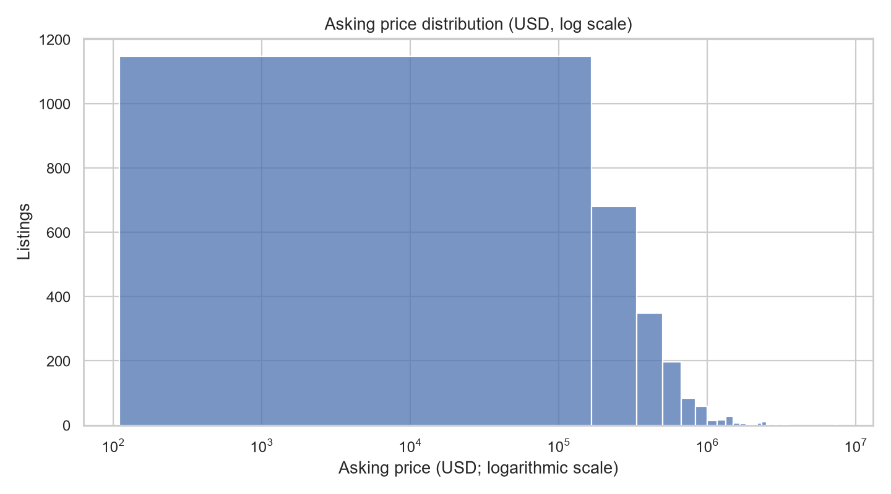
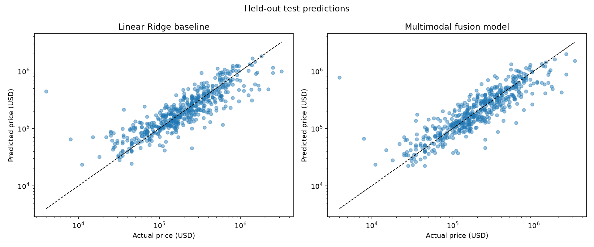
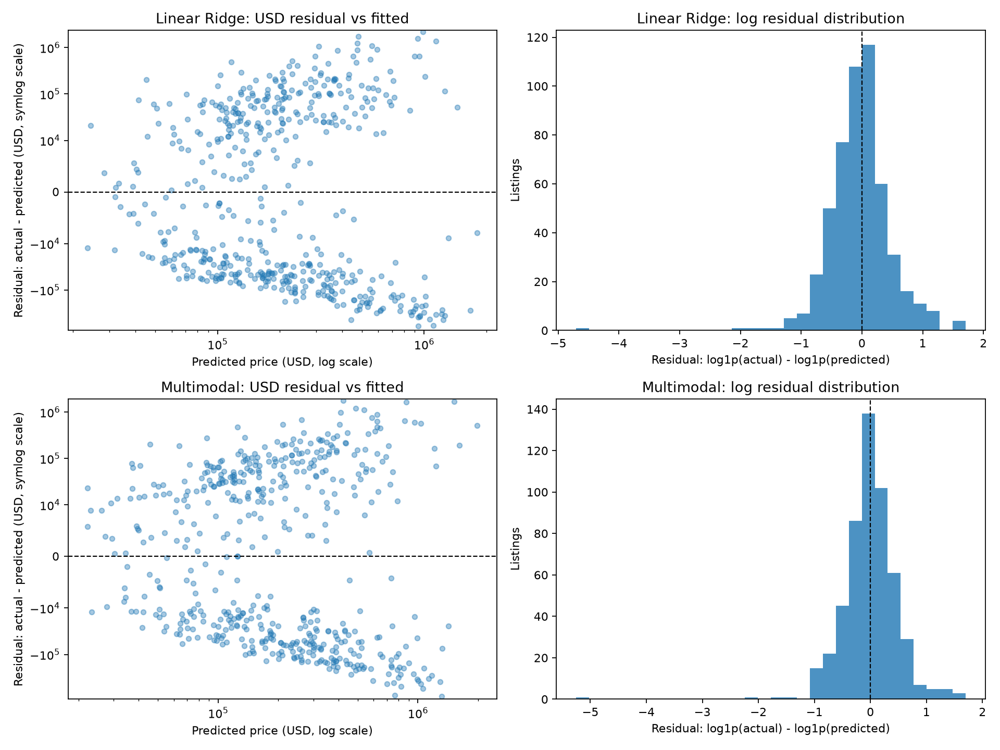

# Zimbabwe House Price Prediction: Short Report

**Data snapshot:** 22 November 2026  
**Currency:** USD asking prices  
**Purpose:** exploratory analysis and a held-out comparison of house-price models

## 1. Data and preparation

The project collected public house listings from [Property.co.zw](https://www.property.co.zw/) using `src/scrape_listings.py`. The source CSV contains 2,646 listings and the `images/` directory contains 2,631 WebP photos. Photo filename prefixes map to listing IDs in `data/houses.csv`; one legacy prefix is zero-padded (`0282` for listing ID `282`). Fifteen source listings have no matching local photo.

The cleaning workflow removed 11 repeated listing URLs, leaving 2,635 unique listings. The owner confirmed that prices are USD, so blank currency labels were treated as USD and this assumption is recorded in the cleaning notebook. Seventeen listings lacked a usable positive price and were excluded from modeling, leaving 2,618 eligible listings. Missing property attributes were imputed within model preprocessing; extreme values were flagged for review rather than automatically removed. The target was transformed with `log1p` during fitting to reduce the influence of the long right tail.

## 2. Exploratory findings

The eligible asking prices are strongly right-skewed: the median is **$198,000**, the mean is **$312,235**, the 90th percentile is **$650,000**, and the maximum is **$7.5 million**. Harare accounts for 1,908 of 2,618 eligible listings (about 73%) and has a median asking price of $240,000; Bulawayo has 285 listings and a median of $180,000. The sample therefore represents the largest cities unevenly and should not be treated as a balanced view of Zimbabwe's housing market.

Missingness is material: currency was blank on 1,897 source rows (72%), floor area on 329 cleaned rows (12.5%), and bathrooms on 288 (10.9%). The USD convention addresses currency labeling but does not remove uncertainty in the underlying listing data.

## 3. Models and evaluation

The Ridge linear-regression baseline uses structured property/location features and train-only TF-IDF description features. The multimodal model combines those structured features with learned description embeddings and frozen ImageNet ResNet18 photo features; a neural fusion branch learns a residual over the linear baseline. Both use `log1p(price_usd)` as the training target.

Listings were divided by a seeded, price-stratified split into 1,781 training, 315 validation, and 522 test rows. Scaling, category levels, text vocabulary, and TF-IDF statistics were learned on training data. The test set was used only for the final comparison.

| Model | Test MAE (USD) | Test RMSE (USD) | Test R² |
|---|---:|---:|---:|
| Linear Ridge (structured + TF-IDF) | $109,676 | $234,135 | 0.565 |
| Multimodal (ResNet18 + text + structured) | **$104,521** | **$217,604** | **0.624** |

The multimodal model improves MAE by about 4.7% and RMSE by about 7.1% on this split. This is a modest single-split gain, not evidence that the extra modalities will improve estimates in every location or price range.

## 4. Residual assessment

Residuals are defined as actual minus predicted, so positive values indicate underprediction. Mean residuals are approximately +$22,515 for Ridge and +$22,051 for the multimodal model; median residuals are closer to zero (-$3,824 and +$604, respectively). The mean/median difference reflects the influence of large misses.

Errors increase substantially with actual price. In the lowest price band ($4,000–$85,000), MAE is about $32,342 for Ridge and $29,923 for the multimodal model. In the highest band ($470,000–$3.2 million), it rises to $330,466 and $298,131. The multimodal model does not win in every band: its MAE is higher than Ridge's in the $155,000–$250,000 band. Residual signs also suggest overprediction at the low end and underprediction at the high end, a tendency toward estimates closer to the dataset's middle.

## 5. Limitations and conclusion

These are asking-price estimates, not transaction-price estimates. Listings are geographically concentrated, property details are incomplete, and only 2,607 of the 2,618 model-eligible listings have a local photo. The vision branch uses frozen ImageNet features rather than a property-specific encoder; description embeddings are learned from this relatively small dataset. The test result comes from one seeded split, so it does not measure uncertainty across different samples or future listings.

The multimodal model is the stronger overall result on this hold-out set, but the errors—especially for expensive properties—are too large for unqualified valuation use. A stronger evaluation should use repeated or time-based splits, broader geographic coverage, verified sale prices, and error reporting by city and price band.
